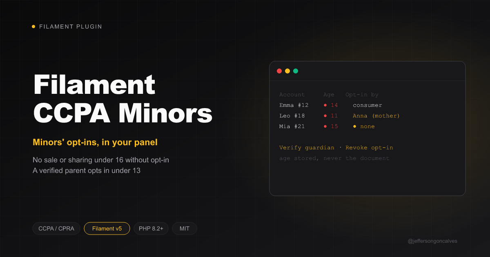

<div class="filament-hidden">



</div>

# Filament CCPA Minors

[](https://packagist.org/packages/jeffersongoncalves/filament-ccpa-minors)
[](https://github.com/jeffersongoncalves/filament-ccpa-minors/actions?query=workflow%3Atests+branch%3A2.x)
[](https://github.com/jeffersongoncalves/filament-ccpa-minors/actions?query=workflow%3A"Fix+PHP+code+styling"+branch%3A2.x)
[](https://packagist.org/packages/jeffersongoncalves/filament-ccpa-minors)
[](LICENSE.md)

Manage the CCPA minors' records (Cal. Civ. Code §1798.120(c): no sale or sharing under 16 without opt-in) kept by [laravel-ccpa-minors](https://github.com/jeffersongoncalves/laravel-ccpa-minors) in your Filament panel.

## Features

- **Age checks:** a read-only list of each result, with the age at the check, the method (marked as reliable or not), the provider and the expiry date. Filter the users under 16. Your app's age check flow records them. Nobody types them in by hand.
- **Guardian links:** link a minor's account to a parent or guardian, then verify or revoke the link. Under 13, only a verified parent or guardian can opt in.
- **Minor opt-ins:** a read-only list of who opted in (the consumer at 13 to 15, or a parent) and when, with a **Revoke opt-in** action.
- 19 languages.

## Compatibility

| Plugin Version                                                              | Filament |
|-----------------------------------------------------------------------------|----------|
| [1.x](https://github.com/jeffersongoncalves/filament-ccpa-minors/tree/1.x) | 3.x      |
| [2.x](https://github.com/jeffersongoncalves/filament-ccpa-minors/tree/2.x) | 4.x      |
| [3.x](https://github.com/jeffersongoncalves/filament-ccpa-minors/tree/3.x) | 5.x      |

## Installation

You can install the package via composer:

```bash
composer require jeffersongoncalves/filament-ccpa-minors:"^2.0"
php artisan vendor:publish --tag="ccpa-minors-migrations"
php artisan migrate
```

## Usage

```php
use JeffersonGoncalves\Filament\CcpaMinors\CcpaMinorsPlugin;

public function panel(Panel $panel): Panel
{
    return $panel
        ->plugins([
            CcpaMinorsPlugin::make()
                ->navigationGroup('CCPA')            // default: no group
                ->navigationSort(7)
                ->subjectModel(\App\Models\User::class)  // default: auth.providers.users.model
                ->subjectTitleAttribute('name'),     // shown next to the id and used to search accounts
        ]);
}
```

All fluent methods are optional.

> The resources have no authorization of their own. Register them only on panels whose users handle privacy, or add policies for the `JeffersonGoncalves\CcpaMinors\Models\*` models.

## Testing

```bash
composer test
```

## Changelog

Please see [CHANGELOG](CHANGELOG.md) for more information on what has changed recently.

## Contributing

Please see [CONTRIBUTING](.github/CONTRIBUTING.md) for details.

## Security Vulnerabilities

Please review [our security policy](../../security/policy) on how to report security vulnerabilities.

## Credits

- [Jefferson Gonçalves](https://github.com/jeffersongoncalves)
- [All Contributors](../../contributors)

## License

The MIT License (MIT). Please see [License File](LICENSE.md) for more information.
